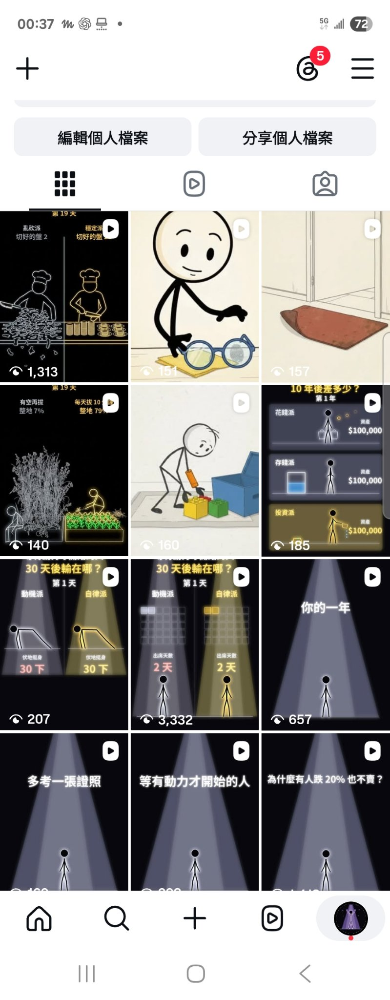
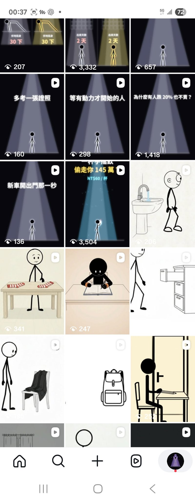

# 火柴人劇場 · Stickman Reels Workflow

**An AI-run stick-figure Reels pipeline — still image → AI video → code overlay → publish → daily data review.**
一個由 AI 實際營運中的火柴人短影音生產線：產圖 → 圖生影片 → 程式疊字 → 多版面發佈 → 每日數據診斷。方法、腳本、真實成績，全部公開。



## 怎麼用：把這個專案交給你的 AI

1. 下載/clone 整個專案。
2. 把專案交給你的 AI（Muse、GPT、Claude Code 都可以），跟它說：**「先讀 AI_START_HERE.md，再讀 README，然後照工作流做。」**
3. AI 讀完就能獨立生產：選題、做片、QA、給發佈文案。

**免費 vs 付費，先講清楚：**
- **完全免費（純程式，不用任何生成 AI）**：同框對照、場景片、暖色故事片、疊字、合成音樂——腳本都在 `scripts/`，有 Python + ffmpeg 就能產出可發佈的成品。
- **需要生成點數（畫面更生動）**：關鍵幀 → Flow/Veo 圖生影片（約 20 點/支）→ 程式疊字。點數是選配，不是門檻。

> 這是 2026 年 11 月才建立的新專案，正在每日營運中，數字與方法持續更新。

## 這條線在做什麼

每天生產 A/B 對照火柴人 Reels（同一個起點、兩種做法、一年後差多少），發佈到 Instagram 與 Facebook 粉專，由 AI 負責選題、生成、疊字、發佈與成效診斷，經營者只做方向決策。這不是概念驗證——是正在跑的帳號，數字是真的。

正在營運中的版面（都是公開宣傳中的連結，歡迎追蹤）：

- YouTube「OneLine Forward」: https://www.youtube.com/@OneLineForwardStudio
- Instagram: [@artbronai0102](https://www.instagram.com/artbronai0102/)
- FB 個人檔案（專業模式）「Ma Pei Wen」: https://www.facebook.com/profile.php?id=61575916052418
- FB 粉專「火柴人劇場」: https://www.facebook.com/profile.php?id=769510329574719
- FB 粉專「Mono Stories」: https://www.facebook.com/profile.php?id=1496718363516277

## 格式規則（從爆款對標拆解出來的骨架）

骨架不是自己發明的——拆解 2026 年 10–11 月新創頻道的爆款（MindFrame Animation 上線兩週兩支 2,200 萬觀看、Visual Mindset 最高 1,000 萬）逐幀歸納：

1. **第一幀就是完整賽局**：提問 + 左右兩方標籤 + 計數器歸零，同框出現。
2. **時間非線性跳躍**：第 1 天 → 第 365 天，輸家在第一次跳躍就凍結（停在個位數），贏家加速衝到誇張量級（8 下 vs 12,480 下；$0 vs $36,500）。
3. **中段要有事件**（約 50–70% 處）：不是直線比賽，是有人放棄、有人登頂、罐子滿出來。
4. **結論要用演的，不用寫的**：結尾是事件畫面（登頂插旗、存錢罐溢出、觀眾鼓掌），不是格言字卡。10 支爆款裡 8 支如此。
5. **最後只留一個提問**：「你是哪一派？／WHICH ONE ARE YOU?」——身分提問，不是道德教訓。
6. **15 秒內**、輕音樂墊底（無聲影片會被平台點名成效較差）、**所有文字用程式疊**（影片生成模型產字必亂碼）。

## 生產流程

```
① 對標選題（要有需求證據：大帳號近期爆款／同題多帳號流動／經典概念庫）
② 產一張關鍵幀靜圖（A/B 對照在構圖裡就要一秒看懂）
③ 圖生影片（Google Flow / Veo 3.1 Fast，8 秒，720×1280）——逐幀驗浮水印
④ 程式疊字（鉤子／天數跳躍／雙邊計數／結尾定格＋提問）＋合成輕音樂
⑤ 各版面發不同版本（不連發相同檔案），排程滴出
⑥ 每日診斷：觀看→留存（跳出率／平均觀看）→追蹤→詢問→收入；
   接近零的影片必須給出原因（帳號狀態／首批分發／留存／跨版面對照），不只報數字
```

## 真實成績（IG @artbronai0102，2026-11-21～22 實測）

| 影片 | 觀看 | 備註 |
|---|---|---|
| 拿鐵因子（一杯咖啡偷走 145 萬） | 3,504 | 帳號最高互動率 |
| 同框版 自律 vs 動機 | 3,332 | 平均觀看 9.5s／14s、重播 824 次 |
| 配息為什麼跌 20% 也不賣 | 1,418 | |
| Flow 刀工對決（圖生影片路線） | 1,313 ↑ | 發佈 25 分鐘時只有 26，持續爬升中 |
| Flow 除草對決 | — | 跳出率 13.2%，全帳號最低 |



## 踩過的雷（誠實區）

- **純程式畫的火柴人動畫像投影片**——動作必須由生成模型演，程式只負責文字層。
- **格言字卡收尾沒人看**——結論要演成事件。
- **同一支影片短時間在多個版面連發相同檔案**——臉書四支全 0。已改為各版面不同版本、錯開時間。
- **無聲影片**——臉書後台直接標示「使用音訊的 Reel 成效更佳」；現在每支都墊合成輕音樂（零版權風險）。
- **臉書個人檔案被演算法歸類為故事型帳號**——解說片在 FB 推不動、同支在 IG 被推給陌生人。版面分工：IG 衝量與追蹤，FB 走故事片與盈利。

## Repo 內容

- `AI_START_HERE.md` — **給 AI 的說明書**：讀完就能照工作流生產，含免費/付費路線分界與 QA 標準。
- `scripts/render25.py` — 疊字引擎：把上述格式規則做成 config 驅動的合成器（鉤子／天數跳躍曲線／輸家凍結或歸零／贏家加速計數／結尾定格提問）。
- `scripts/render16.py` — 同框對照引擎（免費路線）；`scripts/render17.py` — 場景引擎（免費路線）；`scripts/render23.py` — 暖色故事引擎（免費路線）。
- `scripts/make_bed25.py` — 輕音樂合成器：音樂盒琶音＋柔和 pad，純程式合成，無版權問題。
- `assets/` — 帳號後台與主頁截圖（成績證據）。

## 隱私邊界

公開的是**方法與成績**。帳號憑證、生成點數帳本、營運者個人資訊不在此 repo，也不會公開。

## License

MIT
